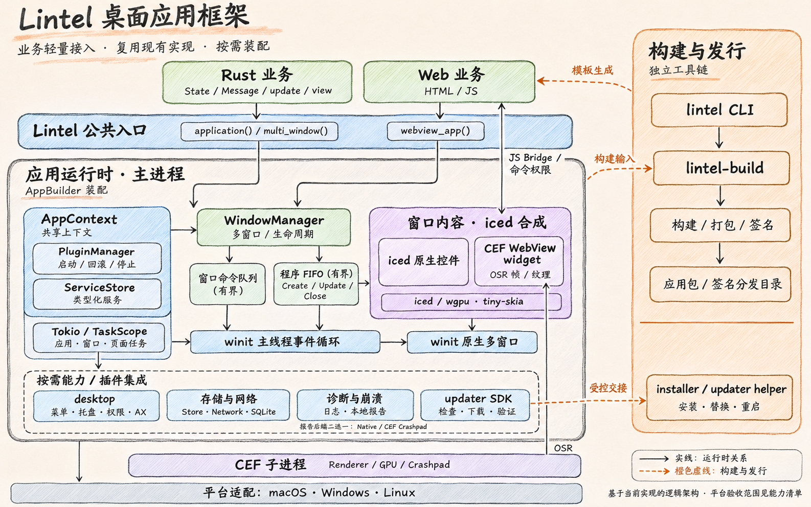

# Lintel

Lintel 是一个基于 Rust、winit、iced 和 CEF 的桌面应用框架，提供原生 UI、混合 WebView、多窗口和按需系统服务。业务通过统一的 `lintel` 入口组织状态、消息和异步任务，再按需要装配插件与服务。

项目同时面向 AI 开发协作和应用工具调用设计：机器可读目录描述入口与能力，协作指南明确源码和验证边界，可选 `agent` 运行时把已授权的业务工具接入现有任务生命周期。

项目提供独立的运行时、窗口路由、插件管理和 CEF WebView 实现。自有 crate 使用 `lintel-` 前缀，Rust 内部引用使用 `lintel_`。

基础能力的公共接口、插件接入和平台范围见[基础能力说明](docs/capabilities.md)。多窗口使用 `multi_window` 与 `WindowManager`，混合应用可在同一个 CEF 运行时配置多个本地页面。`desktop`、`services`、`sqlite`、`updater`、`crash-reporting` 和 `multiprocess` 都是按需 feature。

## crates.io 包名

框架的注册表包名为 `lintel-framework`，Rust 库和业务代码中的接入名为 `lintel`：

```toml
[dependencies]
lintel = { package = "lintel-framework", version = "0.1" }
```

发布状态、补丁依赖与版本顺序见 [发布说明](docs/publishing.md)。独立能力包可以按需使用，不要求应用启用全部功能。

## 架构概览



- **业务入口**：原生应用使用 `application` 或 `multi_window`，保留 `State / Message / update / view`；Web 业务使用 `webview_app`，通过 JS Bridge 调用 Rust 命令。
- **运行时与窗口**：`AppBuilder` 装配主线程事件循环、Tokio 和共享 `AppContext`；`PluginManager` 管理插件生命周期，`ServiceStore` 提供类型化服务。窗口操作队列与程序 `Create / Update / Close` FIFO 分别处理窗口命令和有序程序分发。
- **内容合成**：原生 iced 控件与 CEF WebView 共享窗口内容合成路径，CEF 通过 OSR 提供帧或纹理，多窗口由现有 winit/iced 链路承载。
- **按需能力**：桌面交互、存储、网络、SQLite、诊断、崩溃报告和更新 SDK 按需启用。原生对象由对应宿主持有，业务通过服务接口和普通消息调用。
- **构建与发行**：`lintel CLI` 和 `lintel-build` 负责模板、构建、打包及签名；独立 installer/updater helper 在受控交接后处理安装、替换和重启。

图中展示逻辑分层，具体平台支持与已验收范围见[基础能力说明](docs/capabilities.md)；运行时、插件和任务清理约定见[生命周期文档](docs/runtime.md)。

## AI native 与开发协作

AI 从 [llms.txt](llms.txt) 获取短索引，按 [AGENTS.md](AGENTS.md) 定位源码和选择定向验证；[lintel.project.json](lintel.project.json) 是版本化的项目目录。CLI 使用同一份目录输出机器契约：

```bash
lintel describe --json
```

该命令只返回编译内置目录，不构建、不探测主机或执行当前项目内容。`lintel new` 生成的应用自带自己的 `AGENTS.md` 与 `llms.txt`，说明业务入口、验证命令和目标平台边界。

应用按需启用 `agent` feature，通过 `ToolRegistry` 注册类型化工具，用 `ToolPolicy` 显式授权，再将 `ToolSession` 绑定到应用、窗口或页面的 `TaskScope`。执行提供有界输入/输出、并发、数字进度、超时和取消；工具目录按会话策略过滤，返回稳定错误码。UI 变化继续通过普通 Message/Task 或桌面服务完成。详见 [AI 接入约定](docs/ai-native.md)和[工具运行时](docs/agent-tools.md)。

`application_with_context` 与 `multi_window_with_context` 在插件和服务启动后初始化业务状态，初始化失败经现有退出路径清理并返回原错误。业务可以直接取得服务和创建工具会话，完整示例见 [ai_native_app.rs](examples/ai_native_app.rs)，API 约定见[上下文启动](docs/context-initialization.md)。

模型 provider、token streaming、对话/RAG 和远程 MCP/HTTP transport 将作为独立适配层推进。当前工具执行由应用授权，不自动连接模型或授予文件、网络、shell 权限；同进程 Rust handler 仍是受信任代码。AI Dev Loop 默认关闭，仅在用户明确要求时启用。

## 安装命令行

从 Lintel 根目录安装 Rust 二进制。Cargo 包名是 `lintel-cli`，安装后的命令是 `lintel`。

```bash
cargo +stable install --path crates/lintel-cli --locked
lintel --help
```

CLI 使用独立的 Cargo 锁文件。从源码安装时会把原生模板、混合模板以及公开依赖配置下的框架源码装入 Rust 二进制。安装后的 `lintel new` 可直接从空目录运行，生成应用通过项目内的 `.lintel/framework` 相对路径使用随包源码。应用继续使用框架锁定的 Rust 工具链，并从公开 Git 仓库和 crates.io 解析第三方依赖。需要用某个本地 checkout 开发框架时，可显式传 `lintel new --lintel-path /path/to/lintel`。

便携源码包保留 iced 的上游许可证。CEF 打包会从官方分发目录或已校验的下载归档复制许可和第三方声明文件。Lintel 自有代码使用 [MIT 许可证](LICENSE)，复用组件保留各自的上游许可证与声明。

## 新建原生应用

在 macOS 上用已安装的 CLI 生成独立 Cargo 工程。目标目录可以尚未创建，也可以是空目录。

```bash
lintel new --template native ../my-counter
cd ../my-counter
lintel run
```

模板唯一的直接运行时依赖是 `lintel`。模板自带框架源码、公开图形依赖配置和自己的 `Cargo.lock`。第一次运行时 Cargo 会更新应用包条目，后续可用 `lintel run --locked` 复跑。

```rust
fn main() -> lintel::Result<()> {
    lintel::application(u64::default, update, view)
        .id("dev.example.my-counter")
        .title("Counter")
        .run()
}
```

业务提供状态初始化函数、`update(&mut State, Message) -> Task<Message>` 和 `view(&State) -> Element<'_, Message>`。用 `lintel::iced` 访问 widget 和任务类型。应用 ID 决定本地数据目录，关闭这个窗口会走框架的正常退出流程。已有插件可用 `.plugin(creator)` 装配。多窗口和 CEF 示例继续使用下文的运行入口。

需要多窗口时，`multi_window` 的初始化函数接收 `WindowManager` 并返回状态和首批任务。把句柄存进状态即可打开、关闭、聚焦和调整窗口，`view` 多接收一个 `WindowId`。`on_window_event` 把窗口事件映射为业务消息，`close_request` 可阻止关闭并提示保存。完整示例见 [window_manager.rs](examples/window_manager.rs)。

## 新建混合应用

在任意目录用已安装的 CLI 生成独立的 macOS WebView 应用。目标目录也可以是当前空目录 `.`。

```bash
lintel new --template webview ../my-webview
cd ../my-webview
lintel run
lintel bundle --locked
```

`lintel run` 会直接启动经过检查的开发包。`lintel bundle` 产出可单独打开的 `build/macos/Lintel WebView.app`。第一次构建会使用公开 CEF。若已经有官方 Framework 的完整分发目录，可以给构建命令传 `--cef-path`，或者设置 `CEF_PATH`。模板的 `build.rs` 调用 `lintel-build` 配置主程序和 Helper 使用的 Framework 搜索路径。

```rust
fn main() -> lintel::Result<()> {
    lintel::webview_app()
        .id(concat!("dev.example.", env!("CARGO_PKG_NAME")))
        .title("My WebView")
        .local_page(include_str!("../ui/index.html"))
        .command("greet", |name: String| Ok(format!("Hello, {name}!")))
        .run(env!("CARGO_PKG_VERSION"))
}
```

业务页面加载框架提供的 `lintel.js`，然后用 `await window.lintel.invoke("greet", name)` 调用 Rust。模板把页面嵌入二进制，运行时只向登记的本地主框架开放命令。关窗时由框架先关闭 CEF 浏览器，再关闭原生窗口和 CEF 运行时。可用 `LINTEL_WEBVIEW_LOG=1` 打开诊断日志。

`.window(label, title, html)` 可配置多个本地窗口，`WebviewWindows::reopen(label)` 可重新打开已批准的本地页面。每次重开使用新实例和会话，旧页面的回调会被隔离。`async_command` 接收异步业务方法，JS 的 `invoke` 第三个参数支持 `AbortSignal` 和 `timeoutMs`，宿主期限由 `command_timeout` 配置。每个窗口分别限流，`window_permissions` 将命令授权绑定到具体窗口。完整示例见 [webview_windows.rs](examples/webview_windows.rs)。

## 多进程服务

可选 `multiprocess` feature 集成匹配版本的 Mojo IPC 与服务网络。主进程保留窗口和应用状态，独立服务进程实现 typed Mojom 接口；`.processes(HostConfig)` 将宿主注册到 AppContext，并在启动失败、正常退出和 relaunch 前等待服务回收。阻塞式启动、监管和回收在专用线程执行。

在 macOS 上生成带 UI、独立 Echo 服务和共享协议 crate 的应用，再显式提供可信运行库：

```bash
lintel new --template multiprocess ../my-services
cd ../my-services
lintel run --mojo-runtime /trusted/mojo-native/libmojo_rs_native.dylib
lintel bundle --mojo-runtime /trusted/mojo-native/libmojo_rs_native.dylib
```

业务只依赖 `lintel` 作为框架入口，协议 crate 单独保存 `.mojom` 和生成器依赖。宿主用 `ProcessSpec` 声明服务程序、发布/连接权限、就绪要求和有限重启策略；服务入口通过 `ProcessWorker` 注册实现。UI 用普通 `Task` 连接服务与等待结果。工具 handler 也可调用同一服务，但 AI 工具授权与进程服务授权分别检查。

CLI 读取 `[[package.metadata.lintel.service_processes]]`，使用与主程序相同的 target、profile 和 features 构建登记的 bin，沿用现有 helper、架构/依赖校验和签名流程。运行库不会自动下载或从 cwd/环境加载；需提供匹配 SDK `0.3.0` 的可信库及随附许可证声明。包内路径由框架解析，应用可以整体移动。接入 API、metadata、平台限制与验收见[多进程服务说明](docs/multiprocess.md)。

## WebView 调用独立服务

`webview-multiprocess` 模板将本地页面、类型化 Rust 命令、共享 Mojom 协议和独立 worker 一起生成：

```bash
lintel new --template webview-multiprocess ../my-web-services
cd ../my-web-services
lintel run --cef-path /trusted/cef143 --mojo-runtime /trusted/mojo/libmojo_rs_native.dylib --sign -
```

业务用 `async_command_with_context` 从页面上下文取得 `ProcessHost` 等服务，再等待 typed RPC；不需要全局变量。上下文只保留弱服务表和弱页面会话，窗口标签和 scope 来自宿主。`try_setup` 在默认窗口预约前建立浏览器角色专用服务，失败时回滚尚未创建的预约并返回原错误；原 `setup` 保持预约后的执行顺序。

`wait_ready` 与 `wait_ready_after` 封装有界事件、快照和期限，后者用于重启后的显式重连。服务权限、页面命令授权和任务取消沿用各自既有边界，业务请求不自动重放。完整接入与初始化顺序见 [WebView 服务说明](docs/webview-services.md)。

## 系统服务与进程

启用 `desktop` 后可用 `.desktop()` 安装主线程系统服务，`.on_desktop_event` 映射菜单、托盘和快捷键事件。多窗口 boot 中的 `windows.desktop()` 可取得服务，菜单和对话框等 `Pending` 结果可直接 `await`。Windows 用 `windows.bind_menu(id, menu)` 将 scoped lease 绑定到窗口，在逻辑 Closed 时释放；业务不需要 HWND。完整接入见 [desktop_window.rs](examples/desktop_window.rs)。

`.single_instance()` 将第二次启动转发给主实例，`.protocol_schemes(...)` 配置允许接收的协议。`on_activation` 处理参数、工作目录、URL 和 macOS Dock Reopen，公开依赖配置也提供该原生回调。协议需要在打包或安装时登记系统元数据。运行时与任务取消约定见 [runtime.md](docs/runtime.md)。

`services` 下的 `store`、`network` 和 `diagnostics` 通过 `.plugin(...)` 装配。`sqlite` 增加 SQLite 服务，`FileAccess` 提供目录能力约束的文件读写。示例见 [services.rs](examples/services.rs)。需要原生崩溃报告时，启用 `crash-reporting` 并使用 `.crash_reporting(CrashConfig)`，打包时用 `--crash-reporter` 带入独立助手。报告默认只保存在本地。

混合应用可选择 `.cef_crash_reports(absolute_directory)` 和 `lintel bundle --cef-crash-reports --sign -`，由 CEF 自带 Crashpad 捕获浏览器及沙箱子进程报告；该模式与原生 reporter 互斥，配置不包含上传地址。诊断包可显式导出这两类本地 dump，见 [diagnostic_export.rs](examples/diagnostic_export.rs)。通知、屏幕录制、输入监听和 Accessibility 的平台支持、当前状态与显式申请入口见 [desktop 包说明](crates/lintel-desktop/README.md)。

## 原生无障碍与 Linux

原生 builder 的 `.accessibility()` 配合 `lintel::a11y` helpers，可把按钮、输入框、复选框等的真实语义和动作接到普通业务消息。自定义控件通过 `a11y::semantic(key, label, role, content).on_action(...)` 显式接入，保留自己的布局与绘制。支持 Tab、原生 Focus/Click/SetValue、禁用项和安全输入；密码值不进入语义快照。示例见 [accessibility.rs](examples/accessibility.rs)。

Linux 后端通过 `linux-desktop` 或三个独立 feature 选择 SNI 托盘、X11 快捷键、Wayland portal 快捷键。托盘复用 MenuSpec，不额外运行 GTK loop；portal 绑定仅由业务显式操作发起。协议测试与 Linux target 编译已记录，真实桌面验收边界见 [Linux 后端](crates/lintel-desktop/docs/linux-backends.md)。

跨平台应用内菜单使用 `menu::menu_bar(&state.menu, Message::Menu, content)`，复用 `MenuSpec`，勾选结果由业务 update 回写。支持子菜单、键盘、长菜单滚动和关闭后恢复输入。启用已有 `.accessibility()` 即可导出菜单栏、菜单项、勾选/禁用状态和真实布局；原生辅助动作仍进入普通 Message。示例见 [client_menubar.rs](examples/client_menubar.rs)，平台动作差异见[菜单无障碍说明](docs/menu-accessibility.md)。

## 构建和打包

`lintel-build` 提供项目生成、Cargo 构建、产物定位和 macOS 打包的 Rust API。应用仍按自己的 Cargo 配置和锁文件构建。工具在 stdout 输出产物路径，构建诊断走 stderr。

在刚生成的应用目录运行下面的命令。

```bash
lintel build
lintel run
lintel bundle
```

`build` 返回 Cargo 实际生成的可执行文件。`bundle` 默认输出到应用的 `build/macos/`。两者默认用 Cargo 的开发配置，传 `--release` 切换 release，传 `--locked` 使用已有锁文件。可以用 `--manifest-path`、`--package`、`--bin` 或 `--example` 指定构建目标，也可以用 `bundle --executable <路径>` 打包已有二进制。已有 CEF 二进制在这条路径上通过 `--cef-path` 提供 Framework。

`run` 使用相同的构建选项和依赖检查，开发包默认落在选中包的 `build/macos/run/`。它以选中的 Cargo 包目录为工作目录启动包内可执行文件，继承标准流和应用的退出状态。`--` 之后的参数传给应用。CEF 和动态库从包内加载，构建时的路径和动态加载覆盖变量会从应用环境清除。

Windows 原生可移植包、DLL 注册、PE 依赖校验、当前用户安装及协议 ownership receipt 见 [Windows 打包说明](docs/windows-bundles.md)。Managed 安装使用稳定 launcher、不可变版本目录与签名更新，普通 portable 目录按各自入口使用。公开 Windows CEF 已提供五参 bootstrap/cdylib 源码与 CPU OSR，实验性 `windows-webview` starter 用于 SDK 接入和 API_ONLY 检查；原生链接、执行和打包门槛尚未开放。

`windows inspect-cef --archive` 可在任意宿主核对锁定的三个官方 Windows CEF 归档及完整 SDK 文件树，[来源与哈希](docs/windows-cef-provenance.md)单独记录。`windows sign` 默认输出 Authenticode 签名计划，`--execute` 才在 Windows 执行签名、时间戳和验证；需显式可信 SignTool、证书库与时间戳服务，见 [Windows 签名](docs/windows-signing.md)。

`windows distribution stage` 将最终 portable、同架构 launcher/updater 和更新公钥组成带 Ed25519 签名的离线目录。接收方通过独立可信公钥检查完整文件树，再用 `windows install-distribution` 沿用现有安装保护；默认只检查，生产或安装均需显式执行。见[离线分发说明](docs/windows-distribution.md)。

模板为 `run` 和 `bundle` 生成以下元数据。显式的 `--id` 与 `--name` 优先。打包已有二进制时通过 `--id` 指定应用身份。

```toml
[package.metadata.lintel]
id = "dev.example.my-counter"
name = "Counter"
```

纯原生应用包包含可执行文件和应用元数据。使用现有 CEF 启动入口的应用会从 Cargo 构建结果定位 CEF Framework，并按既有布局装配 Helper。打包先在目标目录所在的卷内暂存，成功后再发布。同名且 ID 相同的包会原子替换，也可以用 `--output-dir` 指定其他目录。

## 自更新

可选的 `lintel-updater` 已提供签名清单、更新下载与校验、macOS 整包替换和退出后重启。业务只需固定更新源和公钥，通过异步接口检查和准备，再沿用自身正常退出流程。`lintel bundle --updater --sign <identity>` 会自动带入独立安装助手，`lintel updater keygen/release` 管理发布密钥与产物。完整接入、原生 UI 示例与首版边界见[自更新说明](docs/updater.md)。

## 签名和验签

在 macOS 上，可在打包时签名，或对已有应用执行签名。下面用 ad-hoc 身份 `-` 验证本地应用的签名完整性。

```bash
lintel bundle --sign -
lintel verify-signature 'build/macos/Counter.app'
lintel sign 'build/macos/Counter.app' --identity -
```

签名先处理内层动态库和 Framework，再处理 Helper，最后签主应用。验签逐一检查组件和完整应用。签名在同卷副本中完成，验签通过后才替换原包。此顺序遵循 Apple 对嵌套代码的签名流程。[Apple 签名说明](https://developer.apple.com/library/archive/technotes/tn2206/)

证书身份可通过 `bundle --sign <identity>` 或 `sign --identity <identity>` 传入。`--hardened-runtime` 启用主程序、Helper 和包内独立可执行工具的 Hardened Runtime，`--timestamp` 为证书签名请求安全时间戳。主程序与 Helper 可分别通过 `--entitlements`、`--helper-entitlements` 提供权限文件，独立工具不会继承这些权限。文件会校验并转换为临时 XML，源文件保留原样。CEF 的 Hardened Runtime 权限应按对应版本和进程需求配置。[Apple Hardened Runtime](https://developer.apple.com/documentation/security/resolving-common-notarization-issues)

本地 ad-hoc 验签用于完整性检查。多版本 Framework 的 ad-hoc 默认签名要求可能互不兼容，这种组合会在签名前报错。实际证书签名和 Apple 公证的发行验收使用项目提供的证书与账户流程。

CEF 在本地使用 ad-hoc 签名并开启 Hardened Runtime 时，可显式使用附带的权限文件。安装后生成的工程在 `.lintel/framework/assets/macos/signing/cef-adhoc` 中包含这些文件；直接使用本仓库时，路径为 `assets/macos/signing/cef-adhoc`。

```bash
entitlements=.lintel/framework/assets/macos/signing/cef-adhoc
lintel bundle --sign - --hardened-runtime \
  --entitlements "$entitlements/loader.plist" \
  --helper-entitlements "$entitlements/loader.plist" \
  --helper-entitlements-for "Renderer=$entitlements/jit.plist" \
  --helper-entitlements-for "GPU=$entitlements/jit.plist" \
  --helper-entitlements-for "Plugin=$entitlements/plugin.plist"
```

`--helper-entitlements-for ROLE=PLIST` 可以重复指定，覆盖相应 CEF Helper 的权限；支持 `default`、`GPU`、`Renderer`、`Plugin`、`Alerts`，其余 Helper 使用 `--helper-entitlements`。角色与生成包中的 Helper 标识对应，未知、重复或包中不存在的角色会报错。Renderer/GPU 单独获得 JIT 权限，通用和 Alerts Helper 不继承这项权限。

这些本地文件针对固定的 CEF 143 配置。ad-hoc 代码没有 Team ID，需要库验证例外才能加载随包 CEF 和 dylib；启用例外时仍保留 Hardened Runtime 与现有 CEF Seatbelt 沙箱。Developer ID 发行配置需要重新核对权限。[本地权限说明](assets/macos/signing/cef-adhoc/README.md)、[Apple 库验证说明](https://developer.apple.com/documentation/bundleresources/entitlements/com.apple.security.cs.disable-library-validation)

## Apple 公证与票据装订

发行构建可以在同一次打包中完成签名、提交 Apple 公证、等待结果、装订票据和验证。`--notarize` 接受已存入钥匙串的 notarytool profile 名，并自动为本次签名开启 Hardened Runtime 和安全时间戳。

```bash
lintel bundle --release \
  --sign 'Developer ID Application: Your Company (TEAMID)' \
  --notarize lintel-release
```

首次使用时，先按 Apple 的流程配置凭据。例如在终端运行以下命令，在安全提示中输入 app-specific password。Lintel 只引用 profile，不接收或保存账户密码。配置已有同名 profile 会覆盖原记录，应由使用者明确执行。

```bash
xcrun notarytool store-credentials lintel-release \
  --apple-id 'you@example.com' --team-id TEAMID
```

已有签名包也可独立提交。默认等待 Apple 接受后，在副本中装订并验证，再替换原包。`--no-wait` 只提交快照，原包保留原样。提交成功会输出 UUID 与状态，可用于之后查询、取日志或继续等待。

```bash
lintel notarize 'build/macos/Counter.app' --keychain-profile lintel-release

lintel notarize 'build/macos/Counter.app' \
  --keychain-profile lintel-release --no-wait
lintel notarization info SUBMISSION_UUID --keychain-profile lintel-release
lintel notarization wait SUBMISSION_UUID --keychain-profile lintel-release --timeout 1800
lintel notarization log SUBMISSION_UUID --keychain-profile lintel-release

lintel staple 'build/macos/Counter.app'
lintel verify-notarization 'build/macos/Counter.app'
```

独立命令可用 `--keychain` 指定凭据所在钥匙串。打包命令对应 `--notary-keychain` 与 `--notary-timeout`。默认等待上限为 600 秒；超时后 Apple 仍可能继续处理，CLI 会保留提交 ID，使用查询和等待命令恢复即可。`wait` 只等待结果，随后对当初上传的同一应用执行 `staple`。可用 `log` 取得 Apple 原始 JSON，检查警告和拒绝原因。

提交前会验证嵌套代码签名、Developer ID Application 证书要求、安全时间戳、进程的 Hardened Runtime 及调试权限。ad-hoc 和 Apple Development 身份不能用于此发行流程。仅 `Accepted` 结果会进入装订；提交失败、公证拒绝、等待超时或装订失败都不会发布暂存包。成功装订后再次修改或签名，需要重新走发行流程。[Apple 公证要求](https://developer.apple.com/documentation/security/notarizing-macos-software-before-distribution)、[Apple 自定义公证流程](https://developer.apple.com/documentation/security/customizing-the-notarization-workflow)

`verify-signature` 校验代码签名完整性；`verify-notarization` 同时校验签名和已装订票据。Apple 的票据验证会访问网络。当前发行流程操作 `.app`；如需分发 ZIP，应在装订完成后重新压缩应用。CEF 的 Hardened Runtime 权限仍按对应版本和进程要求显式提供。

## 管理第三方原生库

在 macOS 应用工程中，可以登记本地预编译的 `lib*.a`、`lib*.dylib` 和 `*.framework`。例如，从应用目录登记、替换或移除一个动态库。

```bash
lintel third-party add codec --path ./sdk/libcodec.dylib --version 1.0.0
lintel third-party list
lintel third-party update codec --path ./sdk-v2/libcodec.dylib --version 2.0.0
lintel third-party remove codec
```

清单保存在应用的 `lintel.third-party.json`。库文件按内容摘要保存在 `.lintel/third-party/`，工程搬移后仍可构建。更新和删除切换生效记录，旧文件可供已经开始的构建继续读取。多包工作区通过 `third-party --manifest-path path/to/app/Cargo.toml` 指定应用包。

`lintel build` 会校验库文件摘要和目标架构，并给选中的 Rust 可执行目标传入链接参数。`lintel bundle` 还会把动态库和 Framework 放入 `Contents/Frameworks`，静态库参与链接。动态库和 Framework 的安装名应使用 `@rpath`，所依赖的其他非系统库也要登记。打包会拒绝无法解析的依赖，成功后再替换旧包。使用包内可执行文件时，相对 RPATH 会定位随包库文件。

发布前，打包器会从暂存包中的主程序和各个 Helper 出发，按实际 Mach-O 加载命令递归检查依赖。检查覆盖 `@rpath`、`@loader_path`、`@executable_path` 和 Framework 自己声明的搜索路径。`bundle --executable` 同样执行检查，因此使用旧可执行文件时也会发现已经移除的依赖。检查失败时保留原有成品包。

## 运行示例

在 macOS arm64 上，从 Lintel 根目录运行。启动脚本默认使用公开 iced `90037336` 加本项目的兼容补丁、公开 wgpu `v28.0.1` 和公开 `iced-rs/winit 0.30.13` 提交 `48116469`。WebView 使用官方 CEF `143.0.14` 并开启 CEF 沙箱。公开模式由 `.cargo/macos-public.toml` 选择 `profiles/macos-public/Cargo.lock`，沿用项目锁定的 nightly 工具链。两个示例都需要 Xcode。WebView 构建还需要 CMake 和 Ninja，旧 WebView 启动脚本用 Python 3 核验已有 CEF 分发目录。

```bash
./scripts/macos.sh native
./scripts/macos.sh webview
```

- 原生示例打开 A、B 两扇窗口。每个窗口都有自己的计数器和关闭按钮。关掉其中一扇后，另一扇继续响应。示例注册的插件记录初始化和退出。
- 混合示例把本地 HTML 嵌进 iced 窗口。点击页面里的按钮可以发起 JS 与 Rust 往返。脚本先生成 `build/macos/Lintel WebView.app`，再从成品包启动，CEF 子进程也使用该包内的 Helper。

加上 `--smoke` 可以运行自动验收。原生用例检查两扇窗口的像素读回、状态更新、关窗和插件退出。混合用例检查页面加载、桥接往返和页面像素合成。关闭时先等 CEF 浏览器关闭，再销毁原生窗口，最后退出事件循环。

```bash
./scripts/macos.sh native --smoke
./scripts/macos.sh webview --smoke
```

成功标记分别为 `native multi-window smoke passed` 和 `LINTEL_WEBVIEW_SMOKE_OK`。公开模式的构建产物默认在 `target/macos-public/`，可用 `CARGO_TARGET_DIR` 覆盖。

默认构建使用仓库中的 `vendor/iced` 与固定的公开依赖提交。现有窗口集成补丁保存在 `profiles/macos-public/iced.patch`，`lintel prepare` 校验 vendored 源码和补丁摘要。`lintel new` 将同一份已验证源码包含到独立项目，不要求访问内部代码托管服务。

WebView 构建需要匹配的官方 CEF SDK。可以通过 CLI 的 `--cef-path` 或构建时的 `CEF_PATH` 指定真实 SDK；原生 UI 的默认依赖图不包含 CEF。SDK 来源、CPU 架构、版本、资源和签名分别验证，不能用 API_ONLY 检查代替实际装载。依赖已缓存时可以使用 `CARGO_NET_OFFLINE=true`。

## 验证范围

```bash
./scripts/check-dependencies.sh
```

运行时与 WebView 沿用已有主线程循环、消息桥接和离屏渲染。原生示例验证多窗口的状态与关闭生命周期，WebView 示例只加载本地演示页。网络图片使用标准 `reqwest`；应用资源页通过受限的本地路径接口选择。

## 图形依赖

| 依赖 | 固定来源与集成 |
|---|---|
| iced | 使用公开提交 `90037336` 加本仓库窗口、事件与资源生命周期补丁，源代码位于 `vendor/iced`。 [上游入口](https://github.com/iced-rs/iced/blob/90037336/winit/src/lib.rs) |
| winit | 使用公开提交 `48116469`，提供窗口、输入和 URL 事件，主循环继续由 Lintel 管理。 [上游提交](https://github.com/iced-rs/winit/tree/48116469f15d3bc52b5e56bb516694be8882870d) |
| wgpu | 使用公开 `v28.0.1` 对应提交 `a6d9d325`，为 iced 内容和 CEF 离屏内容合成提供 GPU 资源。 [上游版本](https://github.com/gfx-rs/wgpu/blob/v28.0.1/wgpu/Cargo.toml) |
| CEF | 使用 `cef-rs` 提交 `348fef2` 与官方 CEF 143 运行时，macOS 沿用 Metal 纹理复制，Windows 采用已有 CPU OSR 路径。 [Metal 修复](https://github.com/tauri-apps/cef-rs/commit/348fef293fd48b053b6157cecc3e05c36d71d0ca) |

macOS arm64 公开成品包已完成本地 ad-hoc 签名和 Hardened Runtime 下的 CEF 沙箱验证。主应用和各 Helper 的 Runtime 签名已核对，主进程、Renderer 与 GPU 的 Runtime 状态经系统查询确认；Renderer/GPU 的 Seatbelt 和拒读检查、WebView 绘制、JS 与 Rust 往返、退出及子进程回收通过。Developer ID 发行签名、Apple 公证和 Windows 运行仍待对应环境验收。
